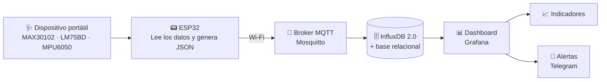
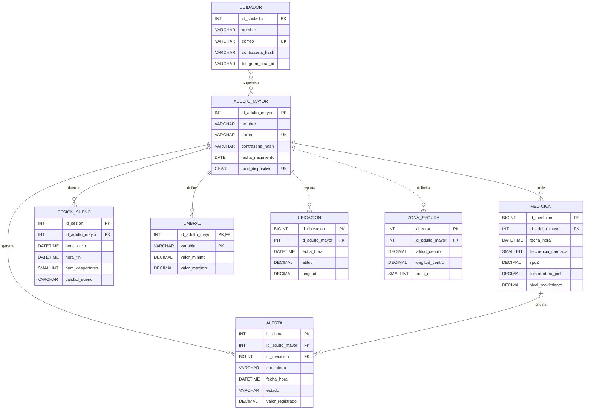

<div align="center">

# 🩺 Monitoreo de Salud para Adultos Mayores con IoT

### Dispositivo wearable de muñeca con sensores biomédicos, almacenamiento de datos y alertas en tiempo real


**Tecnológico de Monterrey** · Implementación del Internet de las cosas · Equipo 9

</div>

---

## 📋 Descripción

Este proyecto propone un sistema de **Internet de las Cosas (IoT)** para el cuidado de la salud de **adultos mayores**. Consiste en un dispositivo portátil, con forma de reloj o pulsera, que mide variables fisiológicas clave de la persona que lo porta.

Los datos se envían de forma inalámbrica a un servidor, donde se almacenan para consultar su historial y se muestran en una aplicación y un dashboard. Si algún valor sale del rango esperado, el sistema **envía una alerta** para avisar de un posible peligro.

La aplicación tiene **dos tipos de usuario**:

- 👵 **Adulto mayor:** usa la pulsera y consulta su propia información de salud.
- 👨‍👩‍👧 **Cuidador o familiar:** supervisa la salud de uno o más adultos mayores y recibe alertas cuando algún valor sale de su rango normal.

## 🎯 Objetivo

Monitorear de forma continua el estado de salud de una persona mayor y detectar a tiempo situaciones de riesgo, mediante un dispositivo wearable de bajo costo, con registro histórico y alertas automáticas.

---

## 🧪 Variables biomédicas y sensores

El sistema adquiere **cuatro variables fisiológicas** mediante **tres sensores**:

| Variable | Descripción | Sensor |
|---|---|---|
| ❤️ Frecuencia cardíaca (BPM) | Ritmo cardíaco por minuto | **MAX30102** |
| 🩸 Saturación de oxígeno (%SpO₂) | Porcentaje de hemoglobina oxigenada en la sangre | **MAX30102** |
| 🌡️ Temperatura de la piel (°C) | Monitoreo térmico para detectar fiebre o hipotermia | **LM75BD** |
| 😴 Calidad del sueño y movimiento | Actividad motora medida por aceleración durante el descanso | **MPU6050** (pendiente de integrar) |

> 🔄 **Cambio respecto a la Etapa 1:** el sensor de temperatura **DS18B20** fue sustituido por el **LM75BD**, debido a su disponibilidad y a su compatibilidad con la comunicación I²C, la misma que usa el MAX30102.

---

## 🏗️ Arquitectura del sistema

El sistema se organiza en **cuatro capas**:

| Capa | Componente | Tecnología | Función |
|---|---|---|---|
| 1. Percepción | Sensores | MAX30102, LM75BD, MPU6050 | Obtienen SpO₂, frecuencia cardíaca, temperatura y movimiento durante el sueño |
| 2. Red | Microcontrolador y conexión | ESP32 + Wi-Fi + MQTT | Recibe los datos de los sensores, los organiza en **JSON** y los envía de forma inalámbrica |
| 3. Procesamiento | Broker y bases de datos | Mosquitto + InfluxDB 2.0 + base relacional | Mosquitto recibe los datos; InfluxDB guarda las mediciones y la base relacional el resto de la información |
| 4. Aplicación | Dashboard y alertas | Grafana + Telegram | Visualiza las mediciones, muestra el historial y envía alertas fuera de rango |

### 🔄 Flujo de datos



---

## 🔌 Montaje y conexiones (Etapa 2)

Los sensores se conectaron al ESP32 mediante el protocolo **I²C**, compartiendo el mismo bus (pines **GPIO 21** para datos y **GPIO 22** para reloj), la alimentación de 3.3 V y la tierra.

| Componente | Pin del sensor | Conexión ESP32 |
|---|---|---|
| MAX30102 | VIN | 3V3 |
| MAX30102 | GND | GND |
| MAX30102 | SDA | GPIO 21 |
| MAX30102 | SCL | GPIO 22 |
| LM75BD | VCC | 3V3 |
| LM75BD | GND | GND |
| LM75BD | SDA | GPIO 21 |
| LM75BD | SCL | GPIO 22 |
| LM75BD | OS | Sin conectar |

**Materiales utilizados:** ESP32 NodeMCU-32S, sensor MAX30102 (MH-ET LIVE), sensor de temperatura LM75BD, protoboard, cables jumper, cable USB-C de datos, computadora con Arduino IDE 2.3.10 y un celular como punto de acceso WiFi.

> El borrador del diagrama de conexiones también contempla el **MPU6050** (dirección propuesta `0x68`) y un módulo **GPS NEO-6M** por UART, ambos aún sin probar o en pruebas.

---

## 🧪 Pruebas realizadas (Etapa 2)

### 1️⃣ Detección de sensores por I²C

Un programa de escaneo con la biblioteca `Wire.h` confirmó que el ESP32 reconoce ambos sensores:

| Sensor | Dirección I²C |
|---|---|
| LM75BD | `0x48` |
| MAX30102 | `0x57` |

### 2️⃣ Lectura simultánea de luz roja, infrarroja y temperatura

Con la biblioteca *SparkFun MAX3010x* y la lectura del registro de temperatura del LM75BD, se obtuvieron datos de ambos sensores al mismo tiempo. Ejemplo de una lectura con el dedo cerca del sensor:

| Variable | Valor registrado |
|---|---|
| Luz roja (Red) | 53,580 |
| Luz infrarroja (IR) | 85,818 |
| Temperatura | 25.125 °C |

> ⚠️ Las lecturas del MAX30102 son intensidades ópticas digitalizadas: todavía **no** son frecuencia cardíaca ni SpO₂. La temperatura del LM75BD corresponde a la del sensor, **no** a la temperatura corporal del usuario.

### 3️⃣ Análisis del ruido de la señal del MAX30102

| Condición | Red | IR |
|---|---|---|
| Sin dedo | 561 – 688 | 330 – 677 |
| Dedo apoyado y quieto | 98,496 | 104,899 – 113,878 |
| Dedo en movimiento | 3,253 – 108,049 | 11,597 – 120,185 |

Con el dedo quieto la señal es relativamente estable; con movimiento aparecen cambios bruscos (**artefactos de movimiento**). Por ello se considera necesario aplicar **filtrado digital** y diseñar una **sujeción** que reduzca el desplazamiento del sensor.

### 4️⃣ Conectividad WiFi y HTTP

- El ESP32 se conectó a una red WiFi de 2.4 GHz (un celular como punto de acceso) y mostró su dirección IP en el monitor serial.
- Con la biblioteca `WebServer.h` se levantó un servidor HTTP. Desde el navegador y desde PowerShell se obtuvo la respuesta `HTTP/1.1 200 OK`, lo que confirma la comunicación por la red local.

### 📡 ¿Por qué WiFi?

| Tecnología | Ventajas | Limitaciones |
|---|---|---|
| **WiFi 802.11 b/g/n** | Conectividad IP, buena velocidad, fácil integración con plataformas IoT | Mayor consumo energético y dependencia de una red |
| Bluetooth Low Energy | Bajo consumo, adecuado para wearables | Requiere un dispositivo cercano o pasarela para acceder a internet |
| LoRa | Largo alcance y bajo consumo | Menor velocidad de datos e infraestructura compatible |
| WiFi 802.11ac | Mayor capacidad de transmisión | No es compatible con el ESP32 utilizado |

Para esta etapa se eligió WiFi por su facilidad de conexión y su compatibilidad con la arquitectura planteada (broker MQTT y dashboard). BLE podría ser más conveniente para reducir el consumo en una versión final.

---

## 🗄️ Diseño de la base de datos

El diseño completo está en [`docs/Base_de_datos_del_RETO.pdf`] (diagrama ER, modelo relacional, diccionario de datos y consultas). Resumen:

### Entidades

| Entidad | Descripción |
|---|---|
| `ADULTO_MAYOR` | Usuario que lleva la pulsera; guarda sus datos de acceso, fecha de nacimiento y el identificador anónimo de su pulsera |
| `CUIDADOR` | Usuario que supervisa a uno o más adultos mayores; guarda su identificador de Telegram para recibir alertas |
| `MEDICION` | Lectura enviada por la pulsera: frecuencia cardíaca, SpO₂, temperatura de la piel y movimiento |
| `SESION_SUENO` | Resumen de cada periodo de sueño (inicio, fin, despertares y calidad) |
| `UMBRAL` | Rango normal de cada variable para cada adulto mayor (entidad débil) |
| `ALERTA` | Evento generado cuando un valor sale de rango o la pulsera deja de enviar datos |
| `UBICACION` *(opcional)* | Posición GPS registrada, solo en exteriores |
| `ZONA_SEGURA` *(opcional)* | Área (casa o asilo) cuya salida genera una alerta |

### Diagrama entidad-relación (resumen)



> Las líneas punteadas indican el **módulo de ubicación**, opcional y en pruebas.

### Decisiones principales del diseño

- Cada adulto mayor usa **una sola pulsera**, por lo que no existe una entidad `PULSERA`: su identificador anónimo (`uuid_dispositivo`) se guarda en `ADULTO_MAYOR`.
- Los **promedios y tendencias no se guardan**: se calculan al mostrarlos, con una consulta o en el programa de la aplicación.
- La **edad** y la **duración del sueño** son atributos derivados: se calculan a partir de otros campos.
- Las alertas se envían por **Telegram** a todos los cuidadores que supervisan al adulto mayor.
- Los **rangos de alerta** son configurables por persona. Como referencia general: SpO₂ normal de 95 % o más (atención por debajo de 92 %) y frecuencia cardíaca en reposo de 60 a 100 lpm. Los límites de temperatura de la piel se definirán con pruebas del equipo.
- Para evitar falsas alarmas, solo se alerta cuando el valor se mantiene fuera de rango durante varias lecturas seguidas (por ejemplo, 5 minutos).
- **Implementación:** las mediciones de alta frecuencia (`MEDICION`) se guardarán en **InfluxDB**, identificadas por el `uuid_dispositivo`; el resto de las tablas, en una base relacional.

### 📱 Qué mostrará la aplicación

| Vista | Contenido |
|---|---|
| **Adulto mayor** | Interfaz simple y de letra grande: semáforo de estado (verde, amarillo o rojo), valores actuales, resumen de la noche, comparación de hoy contra ayer y estado de la pulsera |
| **Cuidador o familiar** | Tarjeta de resumen con semáforo, gráficas por día, semana y mes con banda de rango normal, comparación contra la línea base de la persona, máximos y mínimos con su hora, historial de alertas y lista de adultos mayores supervisados |

**Indicadores del dashboard:** frecuencia cardíaca, SpO₂, temperatura, horas y calidad de sueño, y número de alertas del periodo.

> ⚠️ **Precaución técnica:** el MAX30102 está diseñado para el dedo. En la muñeca las lecturas de SpO₂ y pulso son menos estables, sobre todo con movimiento, por lo que el programa descartará las lecturas dudosas antes de guardarlas o calcular promedios. El sueño se estima solo por movimiento: es un indicador orientativo, no un estudio clínico.

---

## ⌚ Prototipo wearable

El dispositivo está pensado para colocarse **en la muñeca**, en forma de reloj o pulsera. Por ahora es un **prototipo sencillo en protoboard**, con los componentes visibles para facilitar las pruebas y las conexiones.

- **ESP32:** se ubica en la parte principal del dispositivo.
- **MAX30102 y LM75BD:** deben estar en contacto con la piel para medir frecuencia cardíaca, SpO₂ y temperatura.
- **MPU6050:** va fijo dentro del reloj para registrar los movimientos relacionados con la calidad del sueño.
- **Cableado:** corto y ordenado.
- **Alimentación:** batería recargable **LiPo**, para uso portátil.

<!-- Cuando subas imágenes a docs/img/, descomenta y ajusta las siguientes líneas -->
<!-- <p align="center"></p> -->
<!-- <p align="center"></p> -->

---

## 🧰 Tecnologías utilizadas

| Categoría | Tecnología |
|---|---|
| Hardware | ESP32 NodeMCU-32S, MAX30102, LM75BD, MPU6050, batería LiPo |
| Módulo opcional | GPS NEO-6M (UART), en pruebas |
| Comunicación | I²C, Wi-Fi, MQTT, HTTP, JSON |
| Broker | Eclipse Mosquitto |
| Bases de datos | InfluxDB 2.0 (series de tiempo) y base relacional |
| Visualización | Grafana |
| Alertas | Telegram |
| Desarrollo | Arduino IDE 2.3.10, bibliotecas `Wire.h`, `WiFi.h`, `WebServer.h` y *SparkFun MAX3010x* |

---

## 📂 Estructura del repositorio

```
Reto-implementacion-de-internet/
├── README.md
└── docs/
    ├── Cierre_de_ETAPA_1_del_RETO.pdf
    ├── Cierre_de_ETAPA_2_del_RETO.pdf
    └── Base_de_datos_del_RETO.pdf
```

> La estructura se irá ampliando conforme avance el proyecto (código del ESP32, configuración de Mosquitto y Grafana, etc.).

## 📄 Documentación

| Entrega | Contenido | Archivo |
|---|---|---|
| Etapa 1 | Variables, sensores, arquitectura por capas, tecnologías y diseño del prototipo | [Cierre de ETAPA 1](docs/Cierre_de_ETAPA_1_del_RETO.pdf) |
| Base de datos | Diagrama ER, modelo relacional, diccionario de datos y consultas | [Diseño de la base de datos](docs/Base_de_datos_del_RETO.pdf) |
| Etapa 2 | Montaje, pruebas de sensores, análisis de ruido, WiFi y HTTP, códigos utilizados | [Cierre de ETAPA 2](docs/Cierre_de_ETAPA_2_del_RETO.pdf) |

---

## 🚦 Estado del proyecto

**Etapa 1**
- [x] Selección de variables biomédicas y sensores
- [x] Diseño de la arquitectura por capas
- [x] Selección de tecnologías y diagrama de arquitectura
- [x] Diseño del prototipo wearable

**Etapa 2**
- [x] Montaje de MAX30102 y LM75BD en el ESP32 (bus I²C)
- [x] Detección de sensores por I²C
- [x] Lectura simultánea de luz roja, infrarroja y temperatura
- [x] Análisis del ruido de la señal del MAX30102
- [x] Conexión WiFi y servidor HTTP (respuesta 200 OK)
- [x] Diseño de la base de datos

**Próximos pasos**
- [ ] Integrar el MPU6050
- [ ] Calcular frecuencia cardíaca y SpO₂ a partir de las señales ópticas
- [ ] Filtrado digital y diseño de una sujeción estable
- [ ] Envío de datos por MQTT
- [ ] Almacenamiento en InfluxDB y base relacional
- [ ] Dashboard en Grafana y alertas por Telegram
- [ ] Pruebas del módulo GPS (opcional)

---

## 👥 Equipo 9

| Integrante | Matrícula |
|---|---|
| José Miguel Hernández Cruz | A01804683 |
| Ana Teresa Ordoñez Espinosa | A01798485 |
| Miguel Ángel Buendía | A01798876 |

**Profesores:** David Higuera Rosales (etapas del reto) · Roberto Martínez Román (diseño de la base de datos)
**Materia:** Implementación del Internet de las cosas
**Institución:** Tecnológico de Monterrey
